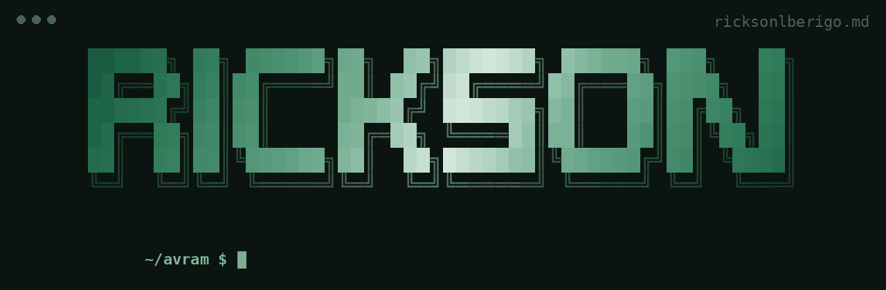
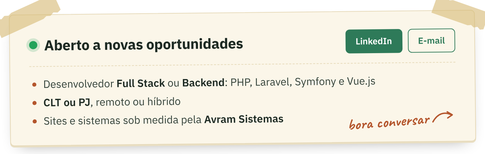
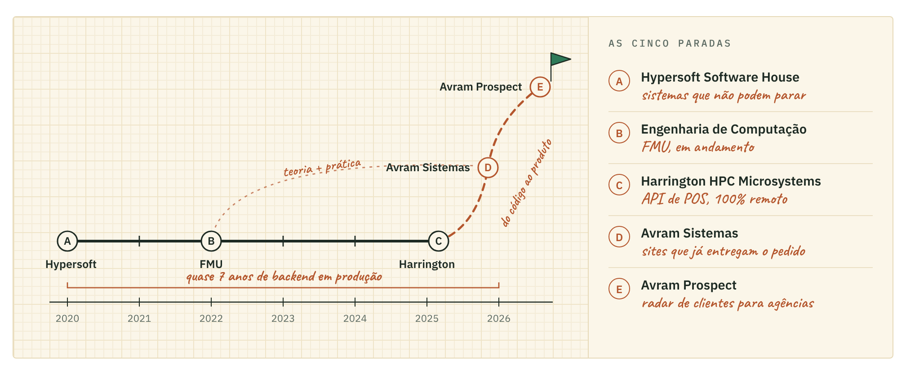

<p align="center">
  
</p>

<p align="center">
  <a href="https://www.linkedin.com/in/ricksonl-berigo"></a>
  <a href="mailto:ricksonl.berigo@gmail.com"></a>
  <a href="https://avramsistemas.com.br"></a>
  
  
</p>

> [!NOTE]
> **TL;DR:** há quase 7 anos eu construo o backend de sistemas que não podem parar: ERPs, plataformas para imobiliárias, APIs de pagamento e integrações com sistemas de terceiros. Hoje também tiro do papel meus próprios produtos pela **Avram Sistemas**.

<p align="center">
  <a href="https://www.linkedin.com/in/ricksonl-berigo">
    
  </a>
</p>

## Oi, eu sou o Rickson 👋

Sou Desenvolvedor Backend na **Hypersoft Software House**, onde trabalho com PHP (Symfony e Laravel) em **arquitetura de microsserviços**, bancos **Oracle** e **Firebird**, filas para processamento assíncrono e regras de negócio que não podem falhar.

Em 2025 desenvolvi, 100% remoto, uma **API de integração com sistemas de ponto de venda** para a Harrington HPC Microsystems, com filas no Redis, cache, logs estruturados e auditoria de dados.

Em paralelo, toco a **[Avram Sistemas](https://avramsistemas.com.br)**, meu estúdio de software: sites e sistemas para pequenos negócios, do design ao deploy, sempre com testes automatizados antes da entrega. É de lá que está saindo o meu projeto principal, o **Avram Prospect**. Também curso **Engenharia de Computação** na FMU.

<p align="center">
  
</p>

## 🚩 Em destaque: Avram Prospect

> **Radar de clientes para agências e freelancers.** Encontra empresas reais por cidade e nicho, qualifica cada oportunidade com critérios explicáveis, organiza tudo num pipeline Kanban e prepara uma prévia de site personalizada para o primeiro contato, publicada com um clique.

- 🏢 **Multi-tenant de verdade:** isolamento por workspace com *Row-Level Security* no PostgreSQL, não só um `where tenant_id`
- ⚙️ **Trabalho pesado em fila:** busca, radar e publicação rodam como jobs no Redis, fora da requisição
- 🤖 **IA no fluxo, com revisão humana:** briefing verificado → copy → design system → landing page de prévia, gerados com Claude Code + Agent Skills
- ☁️ **Prévias publicadas:** cada prévia revisada vai para o Cloudflare Pages com um link próprio
- ✅ **Testado:** mais de 170 testes automatizados em PHPUnit
- 🐳 **Ambiente reproduzível:** app, worker, PostgreSQL e Redis no Docker Compose, com healthchecks

<p>
  
  
  
  
  
  
  
  
</p>

<sub>🔒 Repositório privado, em construção. Posso mostrar ao vivo numa conversa.</sub>

## Outros projetos

-  API multi-tenant de reservas de quadras de areia (vôlei de praia, futevôlei e beach tennis), com integração de pagamentos. `Laravel` `PostgreSQL` `Redis`
-  Rota única de integração para sistemas de ponto de venda, pensada para alta performance: filas, cache, logs estruturados e auditoria. `Laravel` `Redis`
-  Site em que a cliente monta o kit de festa peça por peça e o pedido chega pronto no WhatsApp. 99 testes automatizados em 4 tamanhos de tela, zero erros de acessibilidade. `Astro`
-  Gestão de imobiliárias (Laravel, Jobs/Queues, Firebird), ERP de contratos de modem (Symfony + Oracle) e integrações com APIs de terceiros. `Symfony` `Laravel` `Oracle`

<sub>★ <em>A maior parte do meu código vive em repositórios privados de empresas e clientes.</em></sub>

## Posso ajudar com

```text
╭─ POSSO AJUDAR COM ───────────────────────────────────╮
│  apis · microsserviços · filas · saas · integrações  │
╰──────────────────────────────────────────────────────╯
```

<table>
  <tbody>
    <tr><td><strong>APIs REST</strong></td><td>Contratos claros, versionamento e integração entre sistemas internos e de terceiros.</td></tr>
    <tr><td><strong>Processamento assíncrono</strong></td><td>Jobs, filas e processamento em lote com Redis, sem travar a requisição do usuário.</td></tr>
    <tr><td><strong>SaaS multi-tenant</strong></td><td>Isolamento de dados por cliente, autenticação e cobrança, do jeito certo desde o início.</td></tr>
    <tr><td><strong>Sistemas legados</strong></td><td>Regras de negócio complexas sobre Oracle e Firebird, mantendo o que já funciona no ar.</td></tr>
    <tr><td><strong>Front quando precisa</strong></td><td>Vue.js, Next.js, Livewire e Astro, com testes em vários tamanhos de tela e acessibilidade.</td></tr>
  </tbody>
</table>

##  Um pouco mais sobre mim

```php
<?php

namespace App\Devs;

final class Rickson extends Developer
{
    public string $role     = 'Full Stack Developer';
    public string $location = 'Iturama, MG — Brasil';

    public array $languages = ['PHP', 'JavaScript', 'Python', 'SQL'];

    public array $stack = [
        'backend'  => ['Laravel', 'Symfony', 'Livewire'],
        'frontend' => ['Vue.js', 'Next.js', 'Astro', 'Tailwind CSS'],
        'data'     => ['PostgreSQL', 'Oracle', 'Firebird', 'Redis'],
        'infra'    => ['Docker', 'Cloudflare Pages', 'Git Flow'],
        'ai'       => ['Claude Code', 'Agent Skills'],
    ];

    public array $architecture = ['microsserviços', 'monólito modular', 'multi-tenant', 'filas'];

    public function currentFocus(): string
    {
        return 'Avram Prospect: radar de clientes para agências e freelancers';
    }

    public function openTo(): string
    {
        return 'Full Stack ou Backend · CLT ou PJ · remoto ou híbrido';
    }
}
```

## 🛠️ Stack

<p align="center">
  
  <br />
  
  <br />
  
  
  
</p>

<details>
  <summary><strong>📊 GitHub em números</strong></summary>
  <br />
  <p align="center">
    
    
  </p>
  <p align="center">
    
  </p>
</details>

## Contato

- 💼 LinkedIn: <a href="https://www.linkedin.com/in/ricksonl-berigo">in/ricksonl-berigo</a>
- 📩 E-mail: <a href="mailto:ricksonl.berigo@gmail.com">ricksonl.berigo@gmail.com</a>
- 🌐 Avram Sistemas: <a href="https://avramsistemas.com.br">avramsistemas.com.br</a>

> [!TIP]
> Precisa de um backend que aguenta o tranco, ou de um site que já entrega o pedido pronto? Me chama.

<sub>Banner, cartão e mapa desenhados para este perfil na paleta da Avram Sistemas.</sub>
